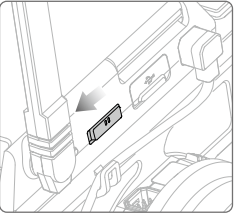
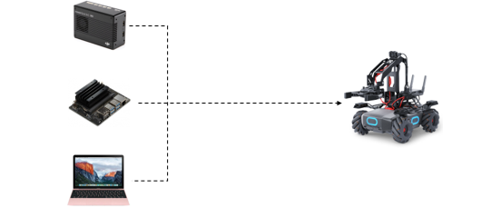
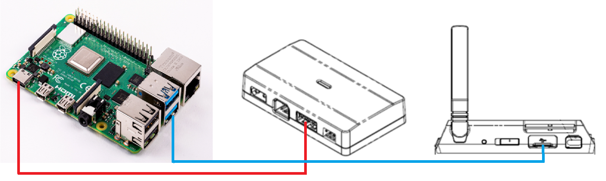
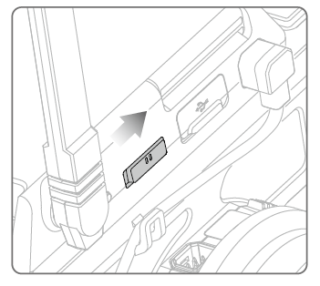
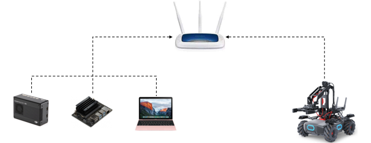
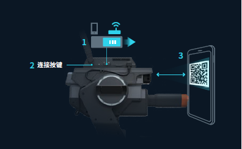
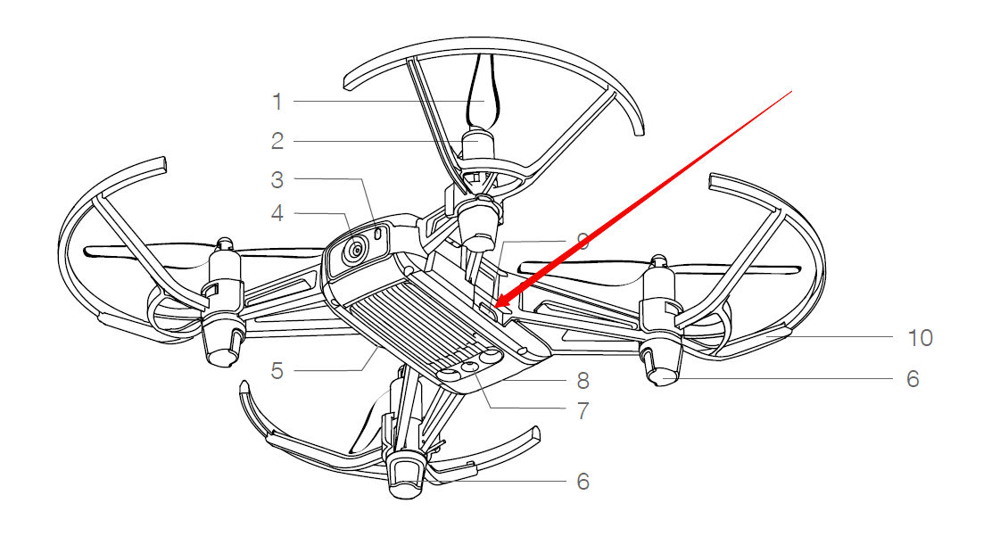

> Source: https://robomaster-dev.readthedocs.io/en/latest/python_sdk/connection.html (DJI, Apache-2.0), converted to Markdown on 2026-11-04.

# 3. Connect the RoboMaster SDK with Robots

## 3.1. EP connection method

The RoboMaster SDK can connect with EP through three methods: Wi-Fi direct connection, Wi-Fi networking, and USB (RNDIS) connection.

1.  **Wi-Fi direct connection**

*Wi-Fi direct connection*: Set the connection method of the robot to direct connection and connect to the robot’s Wi-Fi hotspot. In Wi-Fi direct connection mode, the default IP address of the robot is 192.168.2.1.

- Turn on the robot and set the connection method switch of the smart central control to the **direct connection mode**, as shown in the figure below:

  > 

- Prepare a device with a Wi-Fi connection function, such as DJI Manifold, Jetson Nano, or your PC.

  > > 
  >
  > **Directly connect DJI Manifold, Jetson Nano, or your PC to EP via Wi-Fi connection.**

- Refer to the example in the `/examples/01_robot/04_ap_conn.py` directory of the SDK code ([GitHub RoboMaster SDK repository](https://github.com/dji-sdk/robomaster-sdk)).

    import robomaster
    from robomaster import robot

    if __name__ == '__main__':
        # 如果本地IP 自动获取不正确，手动指定本地IP地址
        # robomaster.config.LOCAL_IP_STR = "192.168.2.20"
        ep_robot = robot.Robot()

        # 指定连接方式为AP 直连模式
        ep_robot.initialize(conn_type='ap')

        version = ep_robot.get_version()
        print("Robot version: {0}".format(version))
        ep_robot.close()

- Execution result:

      Robot Version: xx.xx.xx.xx

2.  **USB connection**

*USB connection*: Connect via the USB port on the robot’s smart central control. In this case, the default IP address of the robot is 192.168.42.2.

The USB connection method essentially uses the RNDIS protocol to virtualize the USB device on the robot as a network card. For information about establishing TCP/IP connections to access more RNDIS content through the USB port, refer to [RNDIS Wikipedia](https://www.wikipedia.org/wiki/RNDIS).

- Choose a third-party platform that has a Type-A USB port and supports RNDIS functions. In the following Raspberry Pi connection example, the blue line in the figure indicates the USB connection, and the red line indicates the power-supply line:

  > 
  > **Raspberry Pi connection diagram**

- Refer to the example in the `/examples/01_robot/06_rndis_conn.py` directory of the SDK code ([GitHub RoboMaster SDK repository](https://github.com/dji-sdk/robomaster-sdk)).

    import robomaster
    from robomaster import robot

    if __name__ == '__main__':
        ep_robot = robot.Robot()

        # 指定连接方式为USB RNDIS模式
        ep_robot.initialize(conn_type='rndis')

        version = ep_robot.get_version()
        print("Robot version: {0}".format(version))
        ep_robot.close()

- Execution result:

      Robot Version: xx.xx.xx.xx

3.  **Networking connection**

*Networking connection*: Set the network connection method of the robot to networking and add the computing device and the robot to the same LAN in order to network them.

- Turn on the robot and set the connection method switch of the smart central control to the **networking mode**.

  > 

- Connect the DJI Manifold, Jetson Nano, or your PC and the EP to the same LAN for EP communication.

  > 
  > **Route the DJI Manifold, Jetson Nano, or PC to EP.**

- Install the myqr library to generate a QR code, press the `Win+R` shortcut command, enter `cmd` in the window that appears to open the CLI, and then enter the following command on the CLI::

      pip install myqr

- Refer to the example in the `/examples/01_robot/05_sta_conn_helper.py` directory of the SDK code ([GitHub RoboMaster SDK repository](https://github.com/dji-sdk/robomaster-sdk)).

    import time
    import robomaster
    from robomaster import conn
    from MyQR import myqr
    from PIL import Image

    QRCODE_NAME = "qrcode.png"

    if __name__ == '__main__':

        helper = conn.ConnectionHelper()
        info = helper.build_qrcode_string(ssid="RoboMaster_SDK_WIFI", password="12341234")
        myqr.run(words=info)
        time.sleep(1)
        img = Image.open(QRCODE_NAME)
        img.show()
        if helper.wait_for_connection():
            print("Connected!")
        else:
            print("Connect failed!")

Warning

In line 13 of the sample code, replace ssid (the router name) and password (the router password) with the actual name and password.

- Run the sample code to display the QR code. Then, press the scan button on the smart central control of the robot, and scan the QR code to connect to the network.

  > 

- Execution result:

      Connected!

The light indicator of the robot changes from blinking white to solid turquoise.

Tip

In networking mode, you can connect to a specified robot by using its SN. To specify the SN of a robot, assign a value to the sn parameter during initialization. Refer to the example in `/examples/01_robot/05_sta_conn_sn.py` ([GitHub RoboMaster SDK repository](https://github.com/dji-sdk/robomaster-sdk)). When sn is not specified, the SDK will establish a connection with the first robot detected by default.

>     from robomaster import robot
>     from robomaster import config
>
>
>     if __name__ == '__main__':
>         ep_robot = robot.Robot()
>         # 指定机器人的 SN 号
>         ep_robot.initialize(conn_type="sta", sn="3JKDH2T001ULTD")
>
>         ep_version = ep_robot.get_version()
>         print("Robot Version: {0}".format(ep_version))
>
>         ep_robot.close()

## 3.2. Connection methods of education-series devices

Currently, the main education-series drones are Tello EDU and Tello Talent. The RoboMaster SDK supports connection with these products via Wi-Fi direct connection.

1.  **Wi-Fi direct connection**

*Wi-Fi direct connection*: Set the connection method of the robot to direct connection and connect to the robot’s Wi-Fi hotspot. In Wi-Fi direct connection mode, the default IP address of the robot is 192.168.10.1.

- First, set the robot to work in Wi-Fi direct connection mode.

  > - *Tello EDU*: Short-press the power button indicated by the red arrow in the figure and wait for the yellow light to flash quickly to indicate successful device startup. The factory default connection method of the robot is Wi-Fi direct connection. If the robot is in networking mode after startup, press the power button to reset the Wi-Fi connection. To do this, long-press the power button for five seconds when the robot is on. During this operation, the status indicator will turn off and then flash yellow. When the status indicator flashes yellow quickly, the SSI and password of the Wi-Fi connection will be reset to their factory default settings. By default, there is no password.
  >
  >   > 
  >
  > - *Tello Talent*:: Turn on the robot and set the mode switch of the extended module to the **direct connection mode**, as shown in the figure below:
  >
  >   > 

- Prepare a device with a Wi-Fi connection function to connect to the Wi-Fi hotspot of the education-series device. This can be a DJI Manifold, Jetson Nano, or your PC.

- Refer to the example in the `/examples/12_drone/01_ap_conn.py` directory of the SDK code ([GitHub RoboMaster SDK repository](https://github.com/dji-sdk/robomaster-sdk)).

    from robomaster import robot

    if __name__ == '__main__':
        # 如果本地IP 自动获取不正确，手动指定本地IP地址
        # robomaster.config.LOCAL_IP_STR = "192.168.10.22"
        tl_drone = robot.Drone()
        # 初始化
        tl_drone.initialize()

        # 获取飞机SDK版本信息
        version = tl_drone.get_sdk_version()
        print("Drone SDK Version: {0}".format(version))

        tl_drone.close()

- Execution result:

      Drone SDK Version: xx.xx.xx.xx

2.  **Networking**

*Networking mode*: Set the robot to work in networking mode and connect to the LAN of the device running the SDK.

- First, set the connection method of the robot to the *direct connection mode* and connect to the device running the SDK. For details, see the previous section.
- Run the provided `/examples/12_drone/23_set_sta.py` sample program ([GitHub RoboMaster SDK repository](https://github.com/dji-sdk/robomaster-sdk)) and replace the ssis and password parameters in the program with the account and password of the current router.

    import robomaster
    from robomaster import robot

    if __name__ == '__main__':
        tl_drone = robot.Drone()
        tl_drone.initialize()

        # 切换飞行器WiFi模式为组网模式，指定路由器SSID和密码
        tl_drone.config_sta(ssid="RoboMaster_SDK_WiFi", password="12341234")

        tl_drone.close()

- Wait several seconds for the TelloEUD device to restart automatically and the extended module of TelloTalent to restart automatically. Then, the device will automatically connect to the LAN of the specified router.
- Connect the device running the SDK to the same LAN so that the SDK and the device are on the same network.

## 3.3. Communication method

### 3.3.1. Communication method for EP

The three methods of connecting the RoboMaster SDK and EP support TCP and UDP communication.

Tip

Use UDP if the robot needs to control movement in real time, and use TCP if the robot needs to perform event-based control.

Select an appropriate communication method based on your application scenario. For more information about TCP communication, refer to [TCP Wikipedia](https://en.wikipedia.org/wiki/Transmission_Control_Protocol). For more information about UDP communication, refer to [UDP Wikipedia](https://en.wikipedia.org/wiki/User_Datagram_Protocol).

1.  TCP communication

- Refer to the example in the `/examples/01_robot/07_tcp_protocol.py` directory of the SDK code ([GitHub RoboMaster SDK repository](https://github.com/dji-sdk/robomaster-sdk)).

    import robomaster
    from robomaster import robot

    if __name__ == '__main__':
        ep_robot = robot.Robot()

        # 指定连接方式为STA 组网模式, 网络通讯方式 tcp
        ep_robot.initialize(conn_type='sta', proto_type='tcp')

        version = ep_robot.get_version()
        print("Robot Version: {0}".format(version))
        ep_robot.close()

- Networking connection

Here, you can modify the *connect_type* parameter in line 8 of the code. `sta` corresponds to networking connection, `ap` corresponds to Wi-Fi direct connection, and `rndis` corresponds to USB connection.

- Run the program and obtain the execution result returned.:

      Robot Version: xx.xx.xx.xx

2.  UDP communication

- Refer to the example in the `/examples/01_robot/08_udp_protocol.py` directory of the SDK code ([GitHub RoboMaster SDK repository](https://github.com/dji-sdk/robomaster-sdk)).

    import robomaster
    from robomaster import robot

    if __name__ == '__main__':
        ep_robot = robot.Robot()
        # 指定连接方式为AP 直连模式, 网络通讯方式 udp
        ep_robot.initialize(conn_type='ap', proto_type='udp')

        version = ep_robot.get_version()
        print("Robot Version: {0}".format(version))
        ep_robot.close()

- Perform networking connection

Here, you can modify the *connect_type* parameter in line 8 of the code. `sta` corresponds to networking connection, `ap` corresponds to Wi-Fi direct connection, and `rndis` corresponds to USB connection.

Tip

Different communication methods are implemented by modifying the *proto_type* parameter of the *robot.initialize()* function in line 8, where `tcp` corresponds to TCP communication and `udp` corresponds to UDP communication.

- Run the program and obtain the execution result returned.:

      Robot Version: xx.xx.xx.xx

### 3.3.2. Communication methods of education-series robots

Currently, Tello EDU and Tello Talent support only UDP communication. Therefore, no extra configuration is required.
