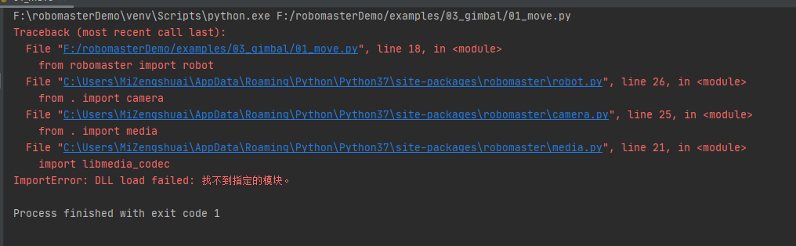

> Source: https://robomaster-dev.readthedocs.io/en/latest/python_sdk/installs.html (DJI, Apache-2.0), converted to Markdown on 2026-11-04.

# 1. Install RoboMaster SDK

## 1.1. Install the SDK on the Windows platform

### 1.1.1. Prepare the development environment

Tip

Before using the Python SDK, ensure that the corresponding Python environment has been installed on the programming platform. If the environment is not installed, install it by referring to [Install the Python Programming Environment](../code_env_setup.html).

### 1.1.2. Install the required VC library

Download the ([GitHub RoboMaster SDK repository](https://github.com/dji-sdk/robomaster-sdk)) ([Alternative download address: Gitee RoboMaster SDK repository](https://gitee.com/xitinglin/RoboMaster-SDK)) and run the executable file of the VC library:

Warning

The following error occurs if you use the SDK without installing the VC library:

### 1.1.3. Install the RoboMaster Python SDK

Install the RoboMaster SDK, click the start menu on your PC, and enter `cmd` in the search box. In the search results, right-click the CLI program and select [\`\`](#id1)Run as Administrator’’. Then, enter the following command::

    pip install robomaster

Tip

If the following error occurs, install the Python environment by referring to [Install the Python Programming Environment](../code_env_setup.html).

### 1.1.4. Upgrade the RoboMaster SDK

To upgrade the RoboMaster SDK, run the following command on the CLI::

    pip install --upgrade robomaster

## 1.2. Install the SDK on the Linux platform

Ubuntu 16.04

Install the Python environment

The following example explains how to install the Python environment in Ubuntu 16.04.

Install the RoboMaster SDK

Install the RoboMaster SDK by running the following command::

    pip install robomaster

Upgrade the RoboMaster SDK

To upgrade the RoboMaster SDK, run the following command on the CLI::

    pip install --upgrade robomaster

Tip

For the process of installing the Python environment on Raspberry Pi, refer to [sdk install on Raspberry Pi.7z](https://github.com/dji-sdk/robomaster-sdk).

## 1.3. Install the SDK on the MacOS X platform

Install the RoboMaster SDK

Install RoboMaster SDK by running the following command::

    pip install robomaster

Upgrade the RoboMaster SDK

To upgrade the RoboMaster SDK, run the following command on the CLI::

    pip install --upgrade robomaster
